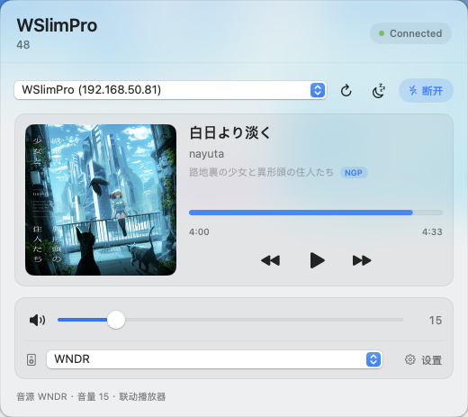

# WDeviceController for macOS

Windows 版 [`WDeviceController`](https://github.com/codecos/WDeviceController) 的 macOS 原生移植：
菜单栏常驻，用与官方 App 一致的 UDP 发现 + WebSocket 协议遥控 WNDR / WRemote 音频设备。



> 个人移植项目，与 Waversa Systems 官方无关。所有设备指令都按 Windows 版反推，
> 仅在 WSlimPro 上实测过，其他机型请自行验证。

## 功能

- 菜单栏图标 + 轻量弹出面板（`NSPanel`，不抢焦点、点击外部自动收起、Esc 关闭）
- 音量 / 静音、音源切换、待机、播放 / 上一首 / 下一首
- FM 频段与预设（`preset_list` 推送）切换
- 设备菜单动态渲染（Output Mode / Digital Filter / Screen Brightness 等），改动即时下发并接受设备回推校正
- UDP 9400 局域网发现 + WebSocket 控制，断线按 2/4/8/16/30 秒退避自动重连
- 可选联动 No Glass Player（WebHost 的 HTTP API）：USB / WNDR 音源下接管 Now Playing 与传输控制
- 全中文界面，深浅色自适应

## 系统要求

- macOS 13 (Ventura) 或更高
- 构建需 Xcode 命令行工具（Swift 5.9+）
- 无第三方依赖

## 构建与运行

```bash
cd WDeviceControllerMac
./scripts/build-app.sh              # Release，产物在 build/WDeviceController.app
open build/WDeviceController.app
```

开发调试：

```bash
swift build -c debug                # 仅编译
CONFIG=debug ./scripts/build-app.sh # 组装 debug 版 .app
```

应用使用 ad-hoc 签名。首次运行时系统会询问本地网络权限，**必须允许**，否则既发现不了设备也连不上。

## 使用

1. 启动后菜单栏出现控制器图标，点击展开面板
2. 面板会自动连接上次使用的设备；换网络后会用 UDP 广播重新扫描并连接发现到的第一台
3. 下拉框里的 `设备名 (IP)` 可手动输入地址；右侧按钮为刷新、重新扫描、断开
4. 音源下拉框切换 USB / WNDR / Optical / Coaxial / FM / Roon Ready 等输入
5. 「设置」进入设备菜单页，每次打开都会重新拉取 `menulist`

## 连接与协议

- 发现：UDP 9400 广播 `search`（与 Windows 版一致），取响应里的 `ipv4_addr`
- 控制：`ws://<ip>:9000`，子协议 `wremote-protocol, json`
- `wndr-port`（如 9200）是音频输出端口，**不是**控制端口；Windows 版的 DnsScanner 同样固定连 9000，
  本移植版也按 9000 连接，旧配置连不上时自动回退
- 设备同一时间只允许一个控制端（先到先得）。手机 App 抢占、设备重启、Wi-Fi 抖动导致的断开，
  会自动退避重连
- 修改设置走 `settings` 报文（`id` / `handler` / `type` / `eeprom_addr` / `value`），
  以设备回推的新 `menulist` 为准；发送失败会回滚界面

## 播放器联动（No Glass Player）

Windows 版的 PlayerLink 走 **Windows 命名管道上的 HTTP**，macOS 没有对应机制，
因此这里直接访问 No Glass Player WebHost 的 HTTP API：

- 发现：UDP 5218 广播 `NGP_WEB_DISCOVER_V1`，取响应中的 `url`
- 状态：`GET /api/health` → `GET /api/state`（1 秒轮询）→ `GET /api/player/queue`（曲目变化时）
- 封面：`GET /api/albums/{albumId}/cover?sharpen=1&w=<edge>`，
  `edge = 168pt × backingScaleFactor × 2`，限制在 `168…720`（1x 屏 336px，Retina 672px）；
  换屏或改缩放后自动按新尺寸重新取图
- 控制：`POST /api/player/pause|resume|next|previous`
- 接管条件：设备音源包含 `usb` 或 `wndr` 且不是 `roon`；此时面板显示 `NGP` 标记，
  播放/上一首/下一首改发播放器，音量仍由设备控制

自动发现失败或多网段时可固定地址：

```bash
defaults write local.wndr.WDeviceControllerMac ngpBaseURL "http://192.168.1.10:5217"
# 或启动时指定：
NGP_BASE_URL=http://192.168.1.10:5217 ./build/WDeviceController.app/Contents/MacOS/WDeviceControllerMac
```

也可在菜单栏图标右键 →「重新发现 No Glass Player」强制重扫。

## 已知限制

- **Roon Ready 兼容性不保证**：相关逻辑是很早以前照着 Windows 版写的，之后没有设备可测，
  行为可能和设备固件版本对不上；能切音源、能显示曲目信息就属于“碰巧可用”，出问题不修。
- **拖拽进度条 seek 未实现**：设备与 No Glass Player 都有 seek 接口
  （`POST /api/player/seek`），但这里只用于切歌时归零，界面上没有可拖动的进度条。
- FM 部分未在带 FM 硬件的机型上实测。
- 未实现开机自启、英文界面、多设备同时保存。

### 播放栏显示条件

只有真的拿到曲目信息（`playstatus` 里有 `title` / `artist`，或 `play_length > 0`）才显示
Now Playing 卡片。Roon Ready 空闲时设备不提供这类信息，卡片与传输控制整体隐藏，
不会出现空白播放栏；切回有内容的音源会自动恢复。

## 调试开关（仅 DEBUG 构建）

```bash
WDC_SHOW_PANEL=1                   # 启动 2 秒后自动展开面板
WDC_OPEN_MENU=1                    # 启动 4 秒后打开设置页
WDC_SELFTEST=1                     # 启动 5 秒后调音量并切换播放，验证发送链路
WDC_DROP_AFTER=6                   # 启动 6 秒后主动断开，验证自动重连
WDC_MENU_TEST="Screeen Brightness" # 启动 6 秒后把该菜单项切到另一个值，5 秒后切回（会真的改设备）
WDC_SOURCE="Roon Ready"            # 启动 7 秒后切到该音源，验证播放栏显示/隐藏
```

## 目录结构

```
WDeviceControllerMac/
├── Package.swift                  # SwiftPM（macOS 13+，可执行 target）
├── Resources/
│   ├── Info.plist                 # LSUIElement、ATS、本地网络说明
│   └── AppIcon.icns
├── scripts/
│   ├── build-app.sh               # SwiftPM 编译 + 组装 .app + ad-hoc 签名
│   └── make-icon.swift            # 由托盘图标生成 .icns
├── docs/panel.png                 # 界面截图
└── Sources/WDeviceControllerMac/
    ├── AppMain.swift              # NSApplication 入口、菜单栏控制器装配
    ├── StatusItemController.swift # 状态栏图标、弹出面板定位/点击外部关闭
    ├── PanelView.swift            # 快捷控制页 / 设置页
    ├── UIComponents.swift         # 面板卡片、按钮、工具条等
    ├── MainViewModel.swift        # 音量防抖、消息分发、菜单、FM、播放器联动
    ├── WebSocketService.swift     # 设备 WebSocket（子协议 wremote-protocol）
    ├── DiscoveryService.swift     # UDP 9400 设备发现
    ├── PlayerLinkService.swift    # No Glass Player 的 HTTP 发现/轮询/控制
    ├── Models.swift               # 设备协议 DTO
    ├── MenuModels.swift           # 菜单 UI 模型
    └── AlbumArtLoader.swift       # 封面加载与降采样
```

## 与 Windows 版的实现差异

- 播放器联动改为 HTTP 直连 WebHost，不再依赖 CoreHost 命名管道
- 设备发现除广播外会额外探测本机网卡所在网段，便于多网卡环境
- 面板用 `NSPanel` 实现，不进入 Mission Control，也不出现在 Dock
- 菜单栏图标使用 SF Symbol 模板图，自动适配深浅色与强调色

## 许可证

[CC0 1.0 Universal](LICENSE)（公有领域奉献）。随便用，无需署名。
